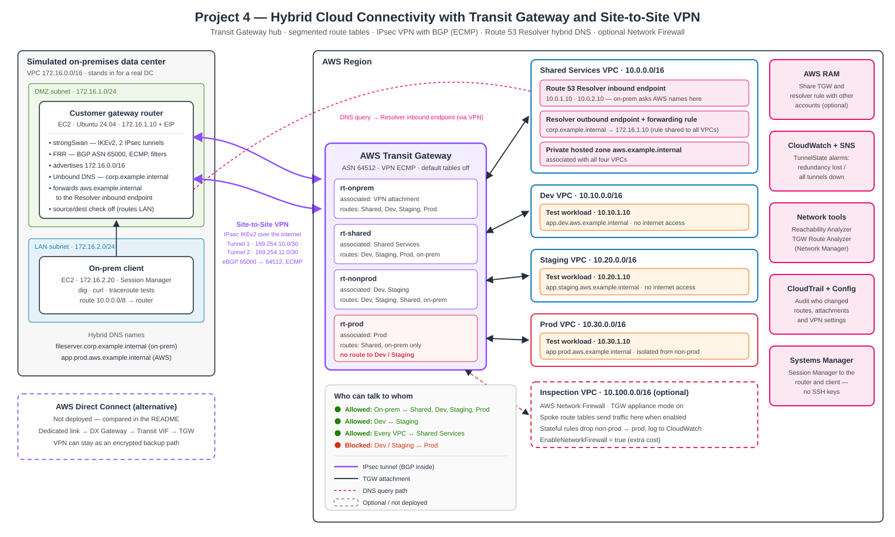

# Hybrid Cloud Connectivity with Transit Gateway and Site-to-Site VPN

AWS Solutions Architect – Associate graduation project (Manara) · **Project 4: Hybrid / Network architecture**

A hub-and-spoke hybrid network that connects an on-premises data center to four AWS VPCs (Shared Services, Dev, Staging, Prod) through an **AWS Transit Gateway**. The on-premises side connects over a **Site-to-Site VPN** with two IPsec tunnels and **BGP** dynamic routing. Separate Transit Gateway route tables keep Prod isolated from non-production. **Route 53 Resolver** endpoints provide split-horizon DNS in both directions. **AWS Network Firewall** centralized inspection and **AWS RAM** sharing are included as optional features.

Because a real data center isn't available, the on-premises side is **simulated in its own VPC** with an Ubuntu EC2 router running strongSwan (IPsec), FRR (BGP) and Unbound (DNS). From AWS's point of view, it's a normal customer gateway connecting over the public internet.

> **Author:** Mahmoud Ahmed Mahmoud Qotb Eissa · [LinkedIn](https://www.linkedin.com/in/mahmoudeissa90)  .

---

## Table of contents

1. [Architecture](#architecture)
2. [AWS services used](#aws-services-used)
3. [IP address and ASN plan](#ip-address-and-asn-plan)
4. [Transit Gateway segmentation](#transit-gateway-segmentation)
5. [Site-to-Site VPN and BGP](#site-to-site-vpn-and-bgp)
6. [Hybrid DNS](#hybrid-dns)
7. [Optional: centralized inspection with Network Firewall](#optional-centralized-inspection-with-network-firewall)
8. [Security design](#security-design)
9. [Repository structure](#repository-structure)
10. [Deployment](#deployment)
11. [Testing the solution](#testing-the-solution)
12. [Direct Connect vs Site-to-Site VPN](#direct-connect-vs-site-to-site-vpn)
13. [Cost estimate](#cost-estimate)
14. [Clean up](#clean-up)
15. [Troubleshooting](#troubleshooting)
16. [Design decisions and trade-offs](#design-decisions-and-trade-offs)
17. [Mapping to the SAA-C03 exam domains](#mapping-to-the-saa-c03-exam-domains)

---

## Architecture



### How traffic flows (on-prem client → Prod app)

1. The on-prem client looks up `app.prod.aws.example.internal`. Its DNS server (Unbound on the router) forwards the query through the VPN to the **Route 53 Resolver inbound endpoint**, which answers from the **private hosted zone**: `10.30.1.10`.
2. The client sends the request to its default router for `10.0.0.0/8`, which is the customer gateway router.
3. The router has learned `10.30.0.0/16` from the Transit Gateway over **BGP**, and sends the packet into one of the two **IPsec tunnels** (ECMP).
4. The VPN attachment is associated with **rt-onprem**, which has a propagated route to the Prod VPC attachment.
5. The Prod VPC route table sends the reply (`172.16.0.0/16`) back to the Transit Gateway. **rt-prod** has the on-prem route learned from BGP, so the reply returns through the tunnel.

---

## AWS services used

| Service | Role in this project |
|---|---|
| **AWS Transit Gateway** | Central hub with 4 VPC attachments and 1 VPN attachment. Default route tables are turned off, and 4 custom route tables enforce segmentation. |
| **AWS Site-to-Site VPN** | Two IKEv2 IPsec tunnels in different AZs on the AWS side, BGP dynamic routing, and ECMP across both tunnels. |
| **Customer gateway** | Represents the on-prem router's public IP and BGP ASN 65000. |
| **Amazon VPC** | Shared Services, Dev, Staging and Prod VPCs (2 AZs each), plus the simulated on-premises VPC and the optional inspection VPC. |
| **Route 53 Resolver** | Inbound endpoint (on-prem → AWS names), outbound endpoint and forwarding rule (AWS → on-prem names). |
| **Route 53 private hosted zone** | `aws.example.internal`, associated with all four VPCs. |
| **AWS Network Firewall** *(optional)* | Stateful inspection of all inter-VPC and hybrid traffic in a central inspection VPC. |
| **AWS RAM** *(optional)* | Shares the Transit Gateway and the resolver rule with another account or the whole organization. |
| **Amazon CloudWatch + SNS** *(optional)* | Alarms on VPN `TunnelState`: one for lost redundancy and one for all tunnels down. |
| **AWS Systems Manager** | Session Manager access to the router and client, with no SSH keys or open SSH ports. |
| **AWS Lambda** | A small custom resource that looks up the VPN's Transit Gateway attachment ID, which CloudFormation does not return. |
| **AWS CloudTrail + AWS Config** | Audit trail for network changes (see [testing step 8](#8-audit-network-changes)). |
| **AWS Direct Connect** | Not deployed. It's compared with VPN in [its own section](#direct-connect-vs-site-to-site-vpn). |

---

## IP address and ASN plan

All ranges are planned so that **nothing overlaps**, which is a hard requirement for routing between networks.

| Network | CIDR | Notes |
|---|---|---|
| Simulated on-prem DC | 172.16.0.0/16 | DMZ 172.16.1.0/24 (router 172.16.1.10), LAN 172.16.2.0/24 (client 172.16.2.20) |
| Shared Services VPC | 10.0.0.0/16 | Resolver inbound 10.0.1.10 / 10.0.2.10, outbound 10.0.1.11 / 10.0.2.11 |
| Dev VPC | 10.10.0.0/16 | Test app 10.10.1.10 |
| Staging VPC | 10.20.0.0/16 | Test app 10.20.1.10 |
| Prod VPC | 10.30.0.0/16 | Test app 10.30.1.10 |
| Inspection VPC *(optional)* | 10.100.0.0/16 | Transit Gateway subnets and the firewall subnet |
| VPN tunnel 1 inside | 169.254.10.0/30 | AWS .1, customer gateway .2 |
| VPN tunnel 2 inside | 169.254.11.0/30 | AWS .1, customer gateway .2 |

| BGP speaker | ASN |
|---|---|
| Transit Gateway (AWS side) | 64512 |
| On-prem router (customer side) | 65000 |

All AWS VPCs fall inside `10.0.0.0/8`, so the on-prem side needs only one summary route, and every VPC needs only two routes to the Transit Gateway: `10.0.0.0/8` and `172.16.0.0/16`.

---

## Transit Gateway segmentation

Default route table association and propagation are **disabled**, so no attachment can reach anything unless a route table explicitly allows it.

| TGW route table | Associated with | Propagated routes (what it can reach) |
|---|---|---|
| `rt-onprem` | VPN attachment | Shared, Dev, Staging, Prod |
| `rt-shared` | Shared Services VPC | Dev, Staging, Prod, on-prem |
| `rt-nonprod` | Dev VPC, Staging VPC | Dev, Staging, Shared, on-prem |
| `rt-prod` | Prod VPC | Shared, on-prem |

The result:

| | On-prem | Shared | Dev | Staging | Prod |
|---|---|---|---|---|---|
| **On-prem** | — | ✅ | ✅ | ✅ | ✅ |
| **Dev** | ✅ | ✅ | — | ✅ | ❌ |
| **Staging** | ✅ | ✅ | ✅ | — | ❌ |
| **Prod** | ✅ | ✅ | ❌ | ❌ | — |

Prod has no route to Dev or Staging, and they have none to Prod. A packet sent between them is dropped at the Transit Gateway.

---

## Site-to-Site VPN and BGP

**Two tunnels for resilience.** Each VPN connection has two tunnels that end on different AWS endpoints in different AZs. Both are kept up. With `VpnEcmpSupport` enabled on the Transit Gateway, traffic is spread across both tunnels, and if one tunnel drops, BGP removes it and traffic continues on the other.

**Route-based VPN.** The on-prem router uses one **XFRM interface per tunnel**, with IPsec selectors set to `0.0.0.0/0 ↔ 0.0.0.0/0`. Routing decisions come from BGP, not IPsec policies, which is how production route-based VPNs work.

**BGP filtering.** The router accepts only AWS prefixes inside `10.0.0.0/8` and advertises only `172.16.0.0/16`. This prevents accidental route leaks in either direction, such as receiving a default route that would pull the router's own internet traffic into the tunnel.

**Static vs dynamic routing.**

| | Static routing | Dynamic routing (BGP) — used here |
|---|---|---|
| How routes are learned | Typed in manually on both sides | Exchanged automatically |
| New VPC or on-prem subnet | Update routes on both sides by hand | Advertised automatically |
| Tunnel failure | Slower failover, often needs dead-peer detection plus manual design | BGP withdraws routes, traffic shifts to the healthy tunnel |
| ECMP across tunnels | Not supported | Supported with Transit Gateway |
| Device requirement | Any IPsec device | Device must support BGP |

---

## Hybrid DNS

Split-horizon DNS lets each side resolve the other's private names, while each side remains authoritative for its own zone.

| Direction | How it works |
|---|---|
| **On-prem → AWS** (`*.aws.example.internal`) | The on-prem DNS server (Unbound) forwards the zone to the **Resolver inbound endpoint** IPs `10.0.1.10` and `10.0.2.10` through the VPN. The inbound endpoint answers from the **private hosted zone**. |
| **AWS → on-prem** (`*.corp.example.internal`) | A **Resolver forwarding rule** for `corp.example.internal`, associated with all four VPCs, sends matching queries through the **outbound endpoint** to the on-prem DNS server `172.16.1.10`. |

Both endpoints live in the **Shared Services VPC**, so there is one place to manage hybrid DNS. In a multi-account setup, the forwarding rule is shared with other accounts through AWS RAM, which is what the optional `SharePrincipal` parameter does.

The `.internal` top-level domain is reserved for private use, so these names can never conflict with real internet domains.

---

## Optional: centralized inspection with Network Firewall

Set `EnableNetworkFirewall = true` to add a central inspection layer:

1. An **inspection VPC** is attached to the Transit Gateway with **appliance mode** enabled, which keeps both directions of a flow on the same firewall endpoint (symmetric routing).
2. The spoke route tables (`rt-shared`, `rt-nonprod`, `rt-prod`) stop using propagated routes and send everything (`0.0.0.0/0`) to the inspection VPC. `rt-onprem` sends `10.0.0.0/8` there instead, because its routes are also advertised to the on-prem router over BGP.
3. The inspection VPC's own route table (`rt-inspection`) has propagated routes from every VPC and the VPN, so traffic can continue to its destination after inspection.
4. A **stateful strict-order rule group** drops Dev/Staging ↔ Prod traffic, allows everything else, and logs drops to CloudWatch Logs (`/<project>/network-firewall/alert`).

This moves segmentation from routing into the firewall, which gives you logging and finer control, for example allowing only port 443 from Dev to Prod. The trade-off is cost and complexity: the lab uses a single firewall endpoint to keep cost down, and production needs one per AZ.

---

## Security design

**Network.** The AWS VPCs have **no internet gateway and no NAT**. The test workloads are reachable only over the private network. Their security groups allow HTTP and ICMP only from `10.0.0.0/8` and `172.16.0.0/16`. The Resolver outbound endpoint can send DNS only to `172.16.1.10`, and the inbound endpoint accepts DNS only from `172.16.0.0/16`.

**Encryption in transit.** All on-prem ↔ AWS traffic is encrypted with IPsec (AES-128, SHA-256, DH group 14 with perfect forward secrecy).

**Secrets.** No pre-shared keys appear in the template or parameters. AWS generates them, and the router reads them at boot through the VPN configuration API using an instance role that allows only `ec2:DescribeVpnConnections`. The router's boot script does not echo commands, so the keys are not written to the boot log, and the config files that contain them are readable only by root.

**Access.** The router and client are managed through **Session Manager**. There are no SSH keys or open SSH ports. **IMDSv2** is required on all instances.

**Least privilege for routing.** Default Transit Gateway association and propagation are disabled, and BGP prefix filters are applied in both directions.

**Audit.** CloudTrail records every Transit Gateway, VPN and Resolver API call. AWS Config (if enabled in the account) keeps a configuration timeline for route tables and attachments.

---

## Repository structure

```
.
├── README.md                    # This documentation
├── infrastructure/
│   └── main.yaml                # CloudFormation template for the whole environment
└── docs/
    ├── architecture.svg         # Architecture diagram (shown above)
    └── architecture.png         # PNG export for slides
```

The router, client and workload configuration are embedded as user data in `main.yaml`, so the whole lab builds from one file.

---

## Deployment

All steps use the AWS Management Console.

### Prerequisites

- An AWS account with permission to create VPC, Transit Gateway, VPN, Route 53 Resolver, EC2, IAM, Lambda and (optionally) Network Firewall and RAM resources.
- A Region with at least two Availability Zones.
- Read the [cost estimate](#cost-estimate) first. **This lab costs about USD 0.86 per hour**, so plan to deploy, test, record and delete in one sitting.

### Steps

1. Open **CloudFormation** and choose **Create stack → With new resources (standard)**.
2. Choose **Upload a template file**, select `infrastructure/main.yaml`, then **Next**.
3. Enter a stack name (for example `hybrid-net`). Parameters:
   - **AlertEmail** — optional; adds the VPN tunnel alarms.
   - **EnableNetworkFirewall** — leave `false` first. You can update the stack to `true` later.
   - **SharePrincipal** — optional; another account ID or your Organization ARN.
   - Leave everything else at the defaults.
4. Choose **Next** twice, select the IAM acknowledgment checkbox, and choose **Submit**.
5. Wait for **CREATE_COMPLETE** (about 15–20 minutes; add about 10 minutes with the firewall).
6. Wait another **5 minutes** for the router to finish configuring itself. Then open **VPC → Site-to-Site VPN connections → your VPN → Tunnel details**. Both tunnels should show **Up**.
7. If you set an alert email, confirm the SNS subscription email.

---

## Testing the solution

Record these tests for your demo video. To open a shell on an instance: **Systems Manager → Session Manager → Start session**, then choose `hybrid-net-onprem-client` or `hybrid-net-onprem-cgw-router`.

### 1. VPN tunnels and BGP

1. In the VPC console, open the VPN connection → **Tunnel details**. Both tunnels are **Up**, and the **Details** column shows **1 BGP ROUTES**, which is the `172.16.0.0/16` prefix the router advertises.
2. On the **router**, run:
   ```bash
   sudo swanctl --list-sas                 # two IKE SAs, both ESTABLISHED
   sudo vtysh -c "show ip bgp summary"     # two neighbors, each with prefixes received
   sudo vtysh -c "show ip route bgp"       # AWS VPC routes with two next hops (ECMP)
   ```

### 2. Transit Gateway route tables

In **VPC → Transit gateway route tables**, open each table and check the **Routes** tab. For example, `rt-prod` shows only `10.0.0.0/16` (Shared) and `172.16.0.0/16` (on-prem, from the VPN), which is the segmentation working.

### 3. On-prem → AWS (routing and inbound DNS)

On the **client**:
```bash
dig app.prod.aws.example.internal +short      # 10.30.1.10, answered by the Resolver inbound endpoint
curl http://app.dev.aws.example.internal
curl http://app.staging.aws.example.internal
curl http://app.prod.aws.example.internal
traceroute -n 10.30.1.10                      # first hop is the router 172.16.1.10
```

### 4. AWS → on-prem (outbound DNS and the return path)

Each `curl` above returns a status page that the workload refreshes every 30 seconds. For example, from Dev:
```
Hello from the dev VPC
Workload IP:                           10.10.1.10
Resolve on-prem name (outbound DNS):   OK (fileserver.corp.example.internal = 172.16.2.20)
Ping on-prem client 172.16.2.20:       OK
Reach staging app (10.20.1.10):        OK
Reach prod app (10.30.1.10):           BLOCKED
```
The second line proves the outbound endpoint and forwarding rule work, and the third proves routing back to on-prem.

### 5. Segmentation

The status pages already show it: Dev and Staging reach each other, but both report Prod as **BLOCKED**, and Prod reports both as **BLOCKED**.

For a visual proof:
1. Open **VPC → Reachability Analyzer → Create and analyze path**.
2. Source: the `dev-app` instance. Destination: the `prod-app` instance. Protocol TCP, port 80.
3. The result is **Not reachable**, with an explanation pointing to the missing route in the `rt-nonprod` Transit Gateway route table.
4. Repeat with destination `staging-app`: **Reachable**.

Each analysis costs about USD 0.10.

### 6. Tunnel failover

1. On the **router**, take tunnel 1 down:
   ```bash
   sudo swanctl --terminate --ike aws-tunnel1
   ```
2. On the **client**, `curl http://app.prod.aws.example.internal` still works through tunnel 2.
3. The VPN console shows tunnel 1 **Down**. With an alert email set, the redundancy-lost alarm fires within about 10 minutes.
4. Bring it back:
   ```bash
   sudo swanctl --initiate --child aws-tunnel1
   ```

### 7. Network Firewall (if enabled)

1. Update the stack with `EnableNetworkFirewall = true` (**CloudFormation → Update → Use current template**).
2. Repeat test 4. The results are the same, but now segmentation is enforced by the firewall.
3. Open **CloudWatch → Log groups → `/<project>/network-firewall/alert`** to see the dropped Dev ↔ Prod flows with the rule message *Blocked non-prod to prod*.

### 8. Audit network changes

1. Open **CloudTrail → Event history** and filter **Event source** = `ec2.amazonaws.com`.
2. You can see `CreateTransitGatewayRouteTable`, `EnableTransitGatewayRouteTablePropagation`, `CreateVpnConnection` and so on, with who made each call and when.
3. If AWS Config recording is enabled in the account, open **Config → Resources**, choose a `AWS::EC2::TransitGatewayRouteTable`, and view its **Resource timeline**.

---

## Direct Connect vs Site-to-Site VPN

| | Site-to-Site VPN (deployed) | AWS Direct Connect |
|---|---|---|
| Path | Encrypted IPsec over the public internet | Dedicated private connection from a DX location |
| Setup time | Minutes | Weeks to months (circuit provisioning) |
| Bandwidth | Up to 1.25 Gbps per standard tunnel; more with ECMP across multiple VPNs | 1, 10, 100 Gbps dedicated; 50 Mbps–25 Gbps hosted |
| Latency and jitter | Varies with internet conditions | Consistent and predictable |
| Encryption | Built in (IPsec) | Not encrypted by default; add MACsec or run VPN over DX |
| Cost model | Hourly connection fee + standard data transfer out | Port hours + lower data transfer out rates |
| Best for | Fast setup, backup links, low-to-medium bandwidth | High, steady throughput; latency-sensitive or large data transfers |

**How Direct Connect would connect here:** DX connection → **Transit VIF** → **Direct Connect gateway** → this Transit Gateway. The existing VPN can stay as an encrypted backup path, and BGP attributes (AS path, local preference) make DX the primary.

---

## Cost estimate

> These are **approximate, unverified** on-demand prices for us-east-1 at the default settings. Check the [AWS Pricing Calculator](https://calculator.aws/) for your Region.

| Item | Rate | Per day |
|---|---|---|
| Transit Gateway VPC attachments (4) | USD 0.05/hour each | ~4.80 |
| Transit Gateway VPN attachment (1) | USD 0.05/hour | ~1.20 |
| Site-to-Site VPN connection | USD 0.05/hour | ~1.20 |
| Route 53 Resolver endpoints (2 endpoints × 2 IPs) | USD 0.125/hour per IP | ~12.00 |
| EC2 (5 × t3.micro) | ~USD 0.0104/hour each | ~1.25 |
| Public IPv4 addresses (2) | USD 0.005/hour each | ~0.24 |
| Lambda, CloudWatch, private hosted zone, data processing | — | < 0.20 |
| **Total (firewall off)** | | **~USD 21/day (~USD 0.86/hour)** |
| Network Firewall endpoint + inspection attachment | +USD 0.395 + 0.05/hour | +~10.70 |
| **Total (firewall on)** | | **~USD 31/day** |

Resolver endpoints are the biggest cost. A 3-hour session (deploy, test, record) costs roughly **USD 3**. **Delete the stack as soon as you finish.**

---

## Clean up

1. In **CloudFormation**, delete the stack. Nothing is retained.
2. Optional: in **CloudWatch → Log groups**, delete the `/aws/lambda/...VpnAttachmentLookup...` log group created by the custom resource.

---

## Troubleshooting

| Symptom | Check |
|---|---|
| Both tunnels **Down** | On the router: `sudo tail -100 /var/log/cloud-init-output.log` and `sudo journalctl -u strongswan --no-pager | tail -50`. The router reads the VPN config at boot, so wait about 5 minutes after the stack completes. |
| Tunnels **Up** but BGP not established | `ip -br addr show type xfrm` should show `xfrm1` and `xfrm2` with 169.254.x.2 addresses. Then `sudo vtysh -c "show ip bgp summary"`. |
| `dig` from the client fails | On the router: `sudo systemctl status unbound`. From the router: `dig @10.0.1.10 app.prod.aws.example.internal`. |
| Status page shows outbound DNS **FAILED** | Check that the resolver rule is associated with that VPC and that the outbound endpoint security group allows port 53 to `172.16.1.10`. |
| Stack fails on `VpnAttachmentLookup` | Open the Lambda function's CloudWatch logs. The VPN attachment must reach the `available` state within about 13 minutes. |

---

## Design decisions and trade-offs

| Decision | Why | Trade-off |
|---|---|---|
| Simulated on-prem in a VPC with an EC2 router | Lets anyone build a real IPsec + BGP VPN without hardware | It runs over the internet between AWS IPs, so latency is lower and more stable than a real branch |
| Transit Gateway instead of VPC peering | Transitive routing, central route control, one VPN for all VPCs | Per-attachment hourly charges plus per-GB processing; peering has no hourly fee |
| Custom TGW route tables, defaults disabled | Explicit, auditable segmentation | More route tables and propagations to manage |
| Resolver endpoints in a Shared Services VPC | One place for hybrid DNS, shareable through RAM | Endpoints are the most expensive part of the lab |
| One VPN connection | Shows the full design at lab cost | For production, add a second customer gateway device or ISP; both tunnels protect only the AWS side |
| Network Firewall optional, single endpoint | Keeps the default lab affordable | Production needs one firewall endpoint per AZ |
| Router security group allows IKE (UDP 500/4500) from anywhere | AWS assigns tunnel IPs at creation, after the security group exists | Could be tightened to the two tunnel IPs after deployment |
| Same PSK source for both sides (AWS-generated) | No secrets in the template or parameters | Anyone with `ec2:DescribeVpnConnections` can read the PSKs; restrict that permission in production |

---

## Mapping to the SAA-C03 exam domains

| Exam domain | Where this project covers it |
|---|---|
| Design secure architectures | Segmented TGW route tables, IPsec encryption, private-only VPCs, scoped security groups, BGP prefix filters, Network Firewall, Session Manager, IMDSv2, CloudTrail and Config auditing |
| Design resilient architectures | Two VPN tunnels in different AZs, BGP failover, ECMP, Resolver endpoints in two AZs, VPN tunnel alarms |
| Design high-performing architectures | Transit Gateway hub-and-spoke, ECMP across tunnels, Direct Connect comparison for bandwidth and latency |
| Design cost-optimized architectures | Shared Services VPC for DNS, optional firewall, single-endpoint lab design, per-hour cost awareness, Direct Connect vs VPN cost model |
